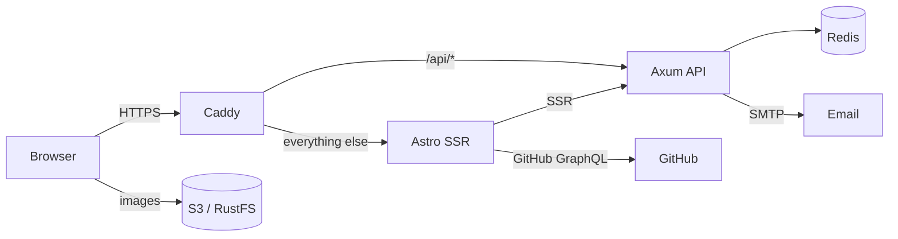

<div align="center">
  <h1>everdev.it</h1>

  <p><strong>Selected work, writing, and reading, in one quiet place.</strong></p>

  <p>
    The source of my personal site. Astro and Svelte on the front,
    Rust and Axum behind it, Caddy at the edge.
  </p>

  <p>
    <a href="https://www.everdev.it"></a>
    <a href="https://github.com/ruizdiazever/portfolio-rs/actions/workflows/ci.yml"></a>
    
    
    
  </p>
</div>

This is the code behind [everdev.it](https://www.everdev.it). It is a bilingual portfolio, a writing archive, a reading list, and a small systems project. The app stays deliberately small: an Astro frontend, a Rust API, Redis, and a media pipeline that keeps images out of the app image.

[Stack](#stack) · [Architecture](#architecture) · [Run locally](#run-locally) · [Media](#media) · [Test](#test) · [Deploy](#deploy)

## Stack

| Layer | What |
| --- | --- |
| Frontend | Astro 7 SSR, Svelte 5, TailwindCSS 4, shadcn-svelte, Paraglide (EN/ZH) |
| API | Rust, Axum, Redis, lettre for feedback email |
| Media | RustFS S3 at `s3.berli.app`, sharp, rclone |
| Edge | Caddy, automatic TLS |
| Delivery | GitHub Actions, GHCR, Docker Compose, pull-based updates |
| Tests | Playwright, `cargo fmt`, `cargo clippy`, `cargo test` |

## Architecture



The browser talks to the API through Caddy on the same origin. The Astro server renders pages and calls the API directly over the private network. Images go straight from S3 to the browser, never through the app.

## Run locally

**Prerequisites:** Node 24, pnpm 10, Rust (CI uses 1.99), Docker.

```bash
cp .env.template .env
cp frontend/.env.template frontend/.env
pnpm -C frontend install

docker compose up -d redis
(cd api && cargo run)          # API at 127.0.0.1:3002
pnpm -C frontend dev           # site at 127.0.0.1:4321
```

`frontend/.env` keeps the browser on the same-origin `/api` path; Vite proxies it to `127.0.0.1:3002` in development. In production, Caddy does that routing.

You do not need media locally. The app points at the public S3 objects in every environment.

## Media

> [!IMPORTANT]
> The local folder and S3 are not duplicates. `frontend/media-src/` is the editable source; S3 is the optimized public copy that the browser downloads. The app serves no content images.

### What lives where

| Location | Role | In Git | Served to the browser |
| --- | --- | --- | --- |
| `frontend/media-src/` | Originals. The files you edit. | Yes | No |
| `frontend/.media-output/v1/` | Generated derivatives, local only. | No | No |
| `s3.berli.app/portfolio/v1/` | The same derivatives, uploaded. | No | Yes |
| `frontend/public/` | `manifest.webmanifest`, `humans.txt`, `browserconfig.xml`. | Yes | Yes |

`frontend/.dockerignore` excludes `media-src/` and `.media-output/` from the frontend image. The frontend build never reads `media-src/`; only `scripts/sync-media.mjs` does. The production container contains code and S3 URLs, not image files.

`frontend/public/` is only for small files that must live at the root, such as the manifest and `humans.txt`. Do not put content images there; they would bypass the pipeline and ship in the app image.

### Why both?

- Git is the source of truth for originals. A crop or replacement is a normal commit, you can review it, and every derivative can be rebuilt from a clean checkout.
- S3 is the delivery layer. It gives the browser a stable public URL and an immutable one-year cache without shipping the originals in the app image or processing images at request time.
- A media change does not require a frontend image rebuild. Upload the new objects and, when a key changes, bump the version.
- `.media-output/` is a staging directory, not a second source. It is ignored by Git and rebuilt from `media-src/`.

S3 holds generated files, not a backup of the source. The source remains in Git. At runtime there is no local image copy and the app has no image endpoint. The tradeoff is deliberate: about 8 MB of originals live in Git and never enter the runtime image, while the browser downloads roughly 3 MB of optimized derivatives from S3.

### The flow

```text
media-src/ (originals, committed)
    │  pnpm media:build
    ▼
.media-output/v1/ (optimized, ignored)
    │  pnpm media:sync (rclone)
    ▼
S3 portfolio/v1 (public, immutable)
    │  HTTPS
    ▼
browser
```

`Media.astro` and `media()` only build the S3 URLs. They never read local files.


```bash
# Generate derivatives locally. No network, no upload.
pnpm -C frontend media:build

# Rebuild and upload. Requires rclone and a configured remote.
RCLONE_CONFIG=~/.config/rclone/rclone.conf pnpm -C frontend media:sync
```

`media:build` writes `frontend/.media-output/v1`. `media:sync` rebuilds that directory and copies it to `${MEDIA_REMOTE:-rustfs}:${MEDIA_BUCKET:-portfolio}/v1` with `Cache-Control: public, max-age=31536000, immutable`.

The app builds URLs with `media()` and `mediaSrcSet()`, and renders `<picture>` elements through `Media.astro`. The URL shape is:

```text
https://s3.berli.app/portfolio/v1/{key}-{width}.{format}
```

### Add or replace an image

1. Put the original in `frontend/media-src/...`.
2. Add a `responsive()`, `single()`, or `og()` call in `frontend/scripts/sync-media.mjs`, or add the book to its `books` array.
3. Run `media:sync`.
4. Reference it with `<Media path="..." />` or `media("...")`.

For a replacement at an existing key, bump `v1` in both `frontend/src/common/media.ts` and `frontend/scripts/sync-media.mjs`. Existing objects are cached as immutable for a year, so reusing a key would keep serving the old file.

`media:sync` needs an rclone remote named `rustfs` with write access to the `portfolio` bucket. Point `RCLONE_CONFIG` at the config file, or override the defaults with `MEDIA_REMOTE` and `MEDIA_BUCKET`. No credentials are committed.

## Repository map

```text
.
├── frontend/
│   ├── media-src/              # original images, committed
│   ├── scripts/sync-media.mjs  # sharp + rclone pipeline
│   ├── src/common/media.ts     # media() and mediaSrcSet()
│   ├── src/components/common/Media.astro
│   └── e2e/                    # Playwright
├── api/                        # Axum API and Redis
├── deploy/                     # Compose stack and update units
├── leptos/                     # pre-Astro implementation, reference only
└── .github/workflows/ci.yml
```

`leptos/` is kept for reference. It is not built, tested, or deployed.

## Test

```bash
pnpm -C frontend test:e2e:install   # first run, installs Chromium
pnpm -C frontend build
pnpm -C frontend test:e2e

cd api
cargo fmt --all --check
cargo clippy --all-targets -- -D warnings
cargo test --locked
```

The Playwright suite covers the pages, the 320 px layout, SEO metadata, S3 assets, the book filters, the language switcher, and feedback. CI runs the same checks on every pull request.

## Deploy

1. CI runs the Rust checks, the Astro build, and Playwright.
2. On `main`, the images job publishes `ghcr.io/ruizdiazever/portfolio-api` and `portfolio-frontend` with `latest` and the commit SHA.
3. The `portfolio` VM pulls and converges the stack from `deploy/compose.yaml` every 10 minutes.

Manual update on the VM:

```bash
sudo systemctl start portfolio-update.service
journalctl -u portfolio-update.service -n 50
```

Caddy terminates TLS for `www.everdev.it`, routes `/api/*` to the API, and sends everything else to the frontend. See [deploy/README.md](deploy/README.md) for the full pipeline and rollback steps.

---

<div align="center">
  <p>Built in Rome with Rust, Astro, Svelte, and Caddy. Type set in EB Garamond and Inter.</p>
  <p>
    <a href="https://www.everdev.it">Live</a> ·
    <a href="https://github.com/ruizdiazever">GitHub</a> ·
    <a href="https://x.com/everruizdiazo">X</a> ·
    <a href="https://www.linkedin.com/in/everdev/">LinkedIn</a>
  </p>
</div>
