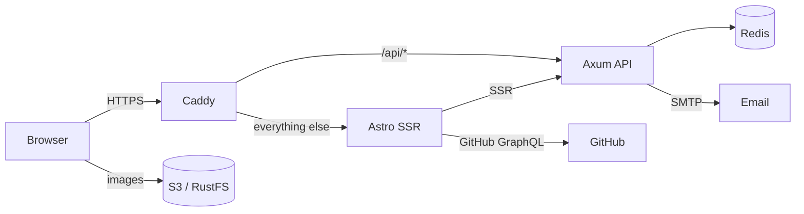

<div align="center">
  <h1>everdev.it</h1>

  <p><strong>Selected work, writing, and reading, in one quiet place.</strong></p>

  <p>
    The source of my personal site. Astro and Svelte on the front,
    Rust and Axum behind it, Caddy at the edge.
  </p>

  <p>
    <a href="https://www.everdev.it"></a>
    <a href="https://github.com/ruizdiazever/portfolio-rs/actions/workflows/ci.yml"></a>
    
    
    
  </p>
</div>

This is the code behind [everdev.it](https://www.everdev.it). It is a bilingual portfolio, a writing archive, a reading list, and a small systems project.

[Stack](#stack) · [Architecture](#architecture) · [The flow](#the-flow) · [Repository map](#repository-map)

## Stack

| Layer | What |
| --- | --- |
| Frontend | Astro 7 SSR, Svelte 5, TailwindCSS 4, shadcn-svelte, Paraglide (EN/ZH) |
| API | Rust, Axum, Redis, feedback email |
| Media | RustFS S3 |
| Edge | Caddy, automatic TLS |

## Architecture



The browser talks to the API through Caddy on the same origin. The Astro server renders pages and calls the API directly over the private network. Images go straight from S3 to the browser, never through the app.

## The flow

```text
source images  →  optimized AVIF/WebP  →  S3  →  browser
```

Images are optimized once and delivered from S3.

## Repository map

```text
.
├── frontend/   # Astro and Svelte
├── api/        # Axum and Redis
├── deploy/     # Compose stack and updates
├── leptos/     # legacy, not built
└── .github/    # CI
```

`leptos/` is the pre-Astro implementation. It is kept for reference and is not part of the build.

---

<div align="center">
  <p><em>“Learning without thought is labor lost; thought without learning is perilous.”</em></p>
  <p><sub>Confucius, Analects</sub></p>
  <p>
    <a href="https://www.everdev.it">Live</a> ·
    <a href="https://github.com/ruizdiazever">GitHub</a> ·
    <a href="https://x.com/everruizdiazo">X</a> ·
    <a href="https://www.linkedin.com/in/everdev/">LinkedIn</a>
  </p>
</div>
